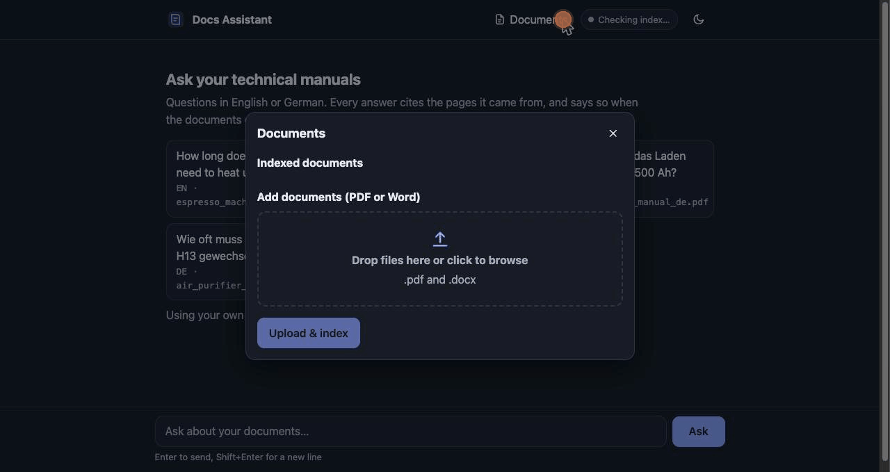
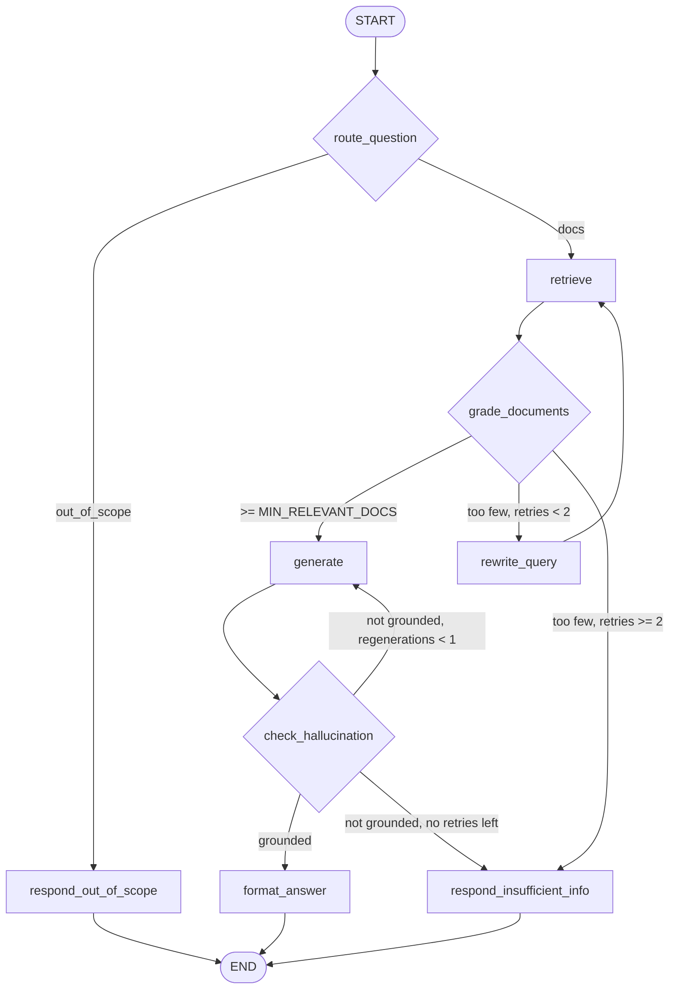

# Agentic Documentation RAG (LangGraph)

Question answering over technical manuals (PDF/DOCX, German + English) with **source citations**.
The agent grades its own retrieval, rewrites weak queries, and verifies that the answer is grounded
before returning it. `eval/` measures it against a naive RAG baseline.

## Demo



The recording shows the full loop in the browser: upload a PDF, ask a two-part question and get a
cited answer, remove the file, then ask about it again and get an honest "not found" instead of a
made-up answer. The manual used is an invented one, so you can reproduce it yourself with
[`docs/demo/verdant_g4_irrigation_manual.pdf`](docs/demo/verdant_g4_irrigation_manual.pdf).

## Architecture



Loops are bounded (`MAX_REWRITES=2`, `MAX_REGENERATIONS=1`); a test proves termination.
Nodes are pure functions `(state, deps) -> partial state`; the LLM and vector store are injected
(`Deps`), so the whole suite runs offline with a fake chat model.

## Quickstart

```bash
python -m venv .venv && source .venv/bin/activate     # or: uv sync
pip install -e ".[dev]"
cp .env.example .env                                   # default provider needs no API key
python -m docrag.ingest --path data/samples --reset    # index the sample manuals
python -m docrag.ask "Wie lange dauert das Laden einer 500-Ah-Batterie?" --trace
python -m docrag.ask "How long does heat-up take?" --baseline   # naive RAG for comparison
```

API: `uvicorn docrag.api:app` (or `docker compose up`), then open `/` for the web UI or call
`POST /ask {"question": "..."}` (response: `answer`, `citations`, `trace`, `declined`, and a
heuristic `confidence`), `POST /ask/stream` (SSE: `node`, `result` and `error` events),
`POST /ingest` (file upload; saved to `data/raw`, returns per-file `results`, 422 for unreadable
files), `GET /sources/{path}` (serves a cited file; only names present in the index are allowed),
`GET /documents` (indexed files with chunk counts), `DELETE /documents/{path}` (removes a file's
chunks from the index and its uploaded copy in `data/raw`; never deletes the committed samples),
`GET /status`, `GET /health`. `source_file` is the path relative to the ingest root.

**Security note:** the API has no authentication. `POST /ingest` and `DELETE /documents/*` change
the index, so run it on localhost or a trusted network only (`docker-compose.yml` publishes the
port on `127.0.0.1`). To expose it, put a reverse proxy with auth or an API key in front.

Tests / quality: `pytest` (offline), `ruff check . && ruff format --check .`, `mypy src eval`.
Evaluation: `python -m eval.run_eval` (calls the LLM, ~700 calls; writes `eval/results/latest.md`).

## Configuration

Everything is an environment variable (see `.env.example`). `LLM_PROVIDER` is `claude_cli`
(default: drives the local `claude` CLI, so it uses your logged-in Claude subscription and needs
no API key; `LLM_MODEL=haiku`), `openrouter` (OpenAI-compatible endpoint), `anthropic` or `openai`.
Embeddings are local and multilingual (`intfloat/multilingual-e5-small`, swappable via
`EMBEDDING_MODEL`). The vector store sits behind a small `VectorStore` protocol (`store.py`).

## Public demo deployment

The API has no authentication, and a hosted model costs money per question, so a public instance
needs two things: no write access, and either no model calls or a hard cap on them. There are two
ways to run one.

### Recorded demo (no model calls, no key, no bill)

`DEMO_REPLAY=true` serves **recorded answers** instead of calling a model. `scripts/record_demo.py`
runs the real pipeline once per example question (against the sample manuals only) and saves each
answer with its citations and reasoning steps to `data/demo_answers.json`; the public app looks
questions up in that file. The UI labels everything as recorded, builds its example cards from the
recorded questions, and answers any other question with a clear "run it locally" message.

- Each answer is one real run. A refusal on a question that should be answerable is re-run, up to
  3 attempts; the script prints how many attempts each answer needed (all 8 took one).
- It needs about 150 MB of RAM. The index is built when the image is built (`Dockerfile.demo`), so
  the running container never loads the embedding model.
- It is read-only and rate limited (`ASK_RATE_PER_MINUTE`), but it cannot run up a model bill
  because it calls no model.

```bash
PYTHONPATH=src python scripts/record_demo.py       # re-record (uses your local LLM setup)
DEMO_REPLAY=true uvicorn docrag.api:app            # run the replay locally
```

**Render:** `render.yaml` deploys `Dockerfile.demo` as one free web service (New, then Blueprint,
then select this repository). It needs no secrets. Free services sleep after 15 minutes without
traffic and take a moment to wake up.

**Hugging Face Spaces:** `scripts/deploy_hf.py` publishes the same image as a Docker Space. It
creates the Space private and only makes it public with `--make-public`.

```bash
huggingface-cli login            # a token with write access
python scripts/deploy_hf.py --space YOUR_USER/docs-assistant-demo                # private
python scripts/deploy_hf.py --space YOUR_USER/docs-assistant-demo --make-public  # when ready
```

`python scripts/deploy_hf.py --dry-run` lists what would be uploaded.

### Live demo (needs a paid model API key)

To let visitors ask their own questions you need a hosted model, which means an API key and a
bill. Settings for a public instance (all off by default):

| Variable | Effect |
|---|---|
| `DEMO_MODE=true` | Read-only: `POST /ingest` and `DELETE /documents/*` return 403, and the UI hides upload and remove. |
| `ASK_RATE_PER_MINUTE=5` | At most 5 questions per minute per client IP (`429` with `Retry-After`). |
| `ASK_DAILY_LIMIT=200` | At most 200 questions per UTC day across all visitors, a spend cap for the key. |
| `PRELOAD=true` | At startup, load the models and index `data/samples` if the index is empty. |

Use the plain `Dockerfile` with `LLM_PROVIDER=openrouter`, a key and `LLM_MODEL` as secrets. The
container then uses about 0.9 GB of RAM, so the free hosting tiers are too small. The limits are
in memory, so they reset on restart and are per instance. If the key is missing the page and index
still load and questions fail with a logged error.

## Evaluation results

Real, unedited output of `python -m eval.run_eval` (43 questions: 34 answerable, 9 unanswerable or
out of scope), measured on 2026-10-15 against an index of the three sample manuals only. Generator
**and** judge are the same model (`claude_cli` / Haiku), embeddings `intfloat/multilingual-e5-small`,
k=6. The three columns come from two invocations of the script with identical settings, the second
run reusing the first one's baseline and `MIN_RELEVANT_DOCS=1` results. Raw data:
`eval/results/*.json`; table: `eval/results/latest.md`.

| Metric | baseline | agentic [MIN_RELEVANT_DOCS=1] | agentic [MIN_RELEVANT_DOCS=2] |
|---|---|---|---|
| Retrieval hit rate@1 | 64.7% | 64.7% | 67.6% |
| Retrieval hit rate@3 | 97.1% | 97.1% | 100.0% |
| Retrieval hit rate@k | 100.0% | 100.0% | 100.0% |
| Answer correctness (LLM judge) | 97.1% | 94.1% | 55.9% |
| Groundedness (LLM judge) | 88.2% | 96.9% | 94.7% |
| Citation accuracy | 87.0% | 85.8% | 51.0% |
| Correct refusal rate (unanswerable) | 88.9% | 100.0% | 100.0% |
| False refusal rate (answerable) | 2.9% | 5.9% | 44.1% |
| Avg latency (s) | 5.76 | 35.93 | 65.45 |
| Avg LLM calls / question | 1.00 | 10.49 | 14.98 |
| Errors | 0 | 0 | 0 |

## Answer correctness by question category

| Category | baseline | agentic [MIN_RELEVANT_DOCS=1] | agentic [MIN_RELEVANT_DOCS=2] |
|---|---|---|---|
| cross_lingual (n=2) | 100.0% | 50.0% | 0.0% |
| lookup (n=16) | 100.0% | 100.0% | 56.2% |
| multi_chunk (n=8) | 100.0% | 100.0% | 75.0% |
| vocab_mismatch (n=8) | 87.5% | 87.5% | 50.0% |

**Reading the numbers honestly**

- **`MIN_RELEVANT_DOCS=2` is still the wrong setting here**: 55.9% correct and 15 of 34 answerable
  questions refused (12 of them after two rewrites). Retrieval was fine (100% hit rate), but each
  answer lives in one page-sized chunk, so the grader rarely finds two relevant chunks. That is
  better than the previous run (38.2% correct, 21 refusals), but far behind `MIN_RELEVANT_DOCS=1`,
  so **the default stays 1**. The setting was chosen after seeing the eval, on the same dataset:
  treat it as tuned, not independently validated.
- With `MIN_RELEVANT_DOCS=1` the agentic graph **does not beat the baseline on correctness**
  (94.1% vs 97.1%, i.e. 32 vs 33 of 34 questions). It is better on **groundedness** (96.9% vs
  88.2%) and on **refusing unanswerable questions** (9 of 9 vs 8 of 9: the baseline has no router,
  so a greeting reaches the generator and was answered). On **citation accuracy** the two are
  level (85.8% vs 87.0%); the baseline was clearly behind in the previous run, so that gap was not
  stable. The price is about **6x the latency and 10x the LLM calls**.
- **Run-to-run noise is real.** The one question the agentic graph newly missed ("How do I reset the
  filter change indicator on the air purifier?") was refused in this run, but answered correctly
  in 6 of 6 repeats of the same question afterwards. The baseline's greeting answer likewise
  differs from the previous run, where it declined. With a single run per configuration and
  n = 43, differences of one or two questions should not be read as real.
- Prompts changed between the previous run and this one (a vocabulary-mismatch rule in the
  generation prompt, and regeneration feedback that keeps supported statements), so the
  movement in the table is not attributable to one change. The `MIN_RELEVANT_DOCS=1` columns are
  otherwise essentially unchanged; the `MIN_RELEVANT_DOCS=2` column improved the most.
- Query rewriting fired on 6 questions at `MIN_RELEVANT_DOCS=1` (22 at 2). This eval has no
  no-rewrite run, so it cannot show whether rewriting helped; the corpus (13 chunks, k=6) is also
  too small to show the benefit rewriting should give on a large library.
- Caveats: one run per configuration (no variance estimate); small n; LLM-drafted dataset that
  **needs human review**; judge = generator model, which can inflate scores.

## Design decisions

- **Structured output everywhere** (`with_structured_output`); no regex parsing of LLM text.
  Citation ids come from a `cited_sources` field, not from scanning `[n]` markers.
- **`claude_cli` provider** wraps `claude -p --json-schema`, so structured output is enforced by the
  CLI and no API key is needed. OpenRouter is supported via `langchain-openai`
  (`method="function_calling"`, the most portable mode).
- **`MIN_RELEVANT_DOCS` default 1 instead of the spec's 2**, based on the eval above.
- **A "decline" answer skips the hallucination judge** (it has no factual claims) and returns no
  citations.
- Deterministic chunk ids (`sha1(relative path|page-or-section|position)`) + upsert = idempotent
  ingestion. Re-ingesting a file adds the new chunks first and only then prunes that file's stale
  ones, so a failed embedding never loses data. A file that fails to load keeps its old chunks.
- API errors return a generic message; the real exception goes to the server log only.
- `confidence` is a deterministic heuristic (relevant-chunk count, rewrites, regenerations,
  grounded verdict), not a calibrated probability; its thresholds are unvalidated.
- E5 models need `query:`/`passage:` prefixes; `E5Embeddings` adds them automatically.

## What I would do next

- A larger, realistic corpus (hundreds of pages, scanned/OCR PDFs, tables) so retrieval is hard.
- Human-reviewed dataset, multiple runs for variance, and a judge from a different model family.
- Grade chunks with a cheaper/faster model and drop the per-chunk grader when the reranker score is
  decisive, to cut the 10x call overhead.
- Hybrid (BM25 + dense) retrieval and a cross-encoder reranker; Qdrant/pgvector behind `VectorStore`.

## Known limitations

- With 13 chunks and k=6 a query retrieves about 46% of the index, so hit rate@6 says little; the
  hit@1 and hit@3 rows are the more informative retrieval numbers.
- The rewrite path is covered by unit tests, but the eval cannot isolate its effect and there is no
  harder vocabulary-mismatch benchmark yet.
- Cross-lingual retrieval is weak: a German question about the English espresso manual can return
  chunks from other manuals. Only 2 dataset items cover this.
- Chunking is barely exercised by the samples (every page/section is one chunk); splitting is
  covered by unit tests on long synthetic text only.
- The web UI was checked by hand against a live model, not by automated browser tests; only the
  answer-formatting parser has unit tests.

- Sample corpus is tiny and synthetic (3 manuals, 13 chunks): retrieval is easy (100% hit rate even
  for naive RAG), so the eval cannot demonstrate the value of query rewriting; results will not
  transfer to a real manual library.
- Agentic mode is slow (about 36 s/question through the CLI provider) and uses ~10 LLM calls.
- The eval dataset is LLM-drafted and **needs human review**; the judge may share a model family
  with the generator.
- Language detection (`langdetect`) is unreliable on short chunks.
- No OCR for scanned PDFs; tables in DOCX are not extracted.
